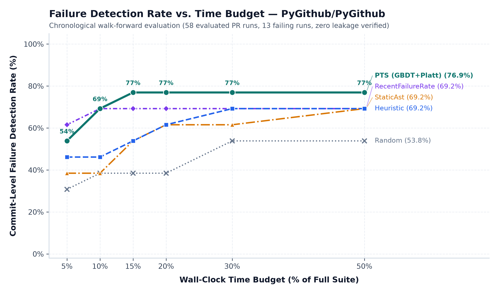
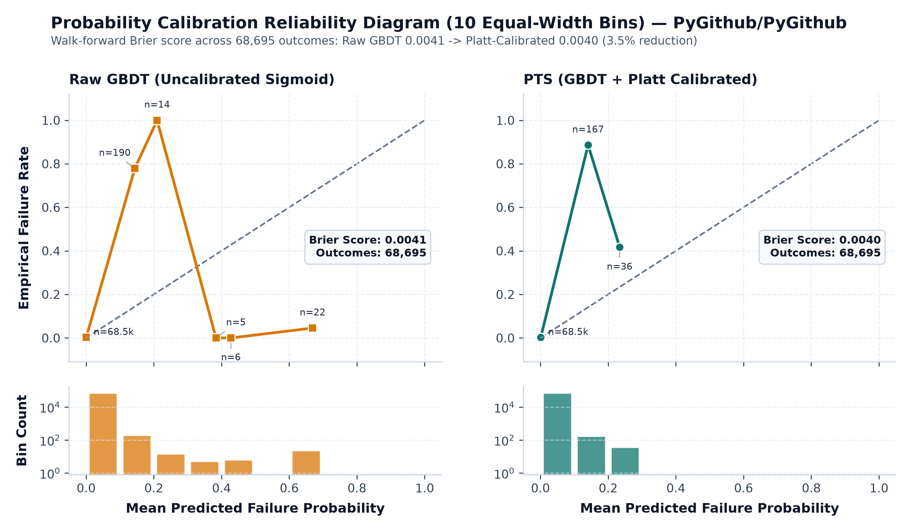

# PTS — Predictive Test Selector

[](https://github.com/AL3XPI/pts/actions/workflows/ci.yml)
[](LICENSE)

**PTS (`pts`)** is a single-binary, pure-Rust CLI and local stdio MCP server that predicts which subset of a repository's test suite is most likely to fail for a given working-tree `git diff`, runs the highest-value tests within a strict time or count budget, and records outcomes locally to improve over time.

- **Zero external infrastructure:** Single self-contained Rust binary (Edition 2024). Statically linked SQLite (`rusqlite` bundled), pure-Rust GBDT (`forust-ml`) + Platt calibration, and Tree-sitter Python AST import analysis—no Python ML dependencies, no database servers, no cloud API calls.
- **Cost-aware selection with anti-starvation:** Maximizes failure probability per millisecond (`prob / eff_ms`) with a deterministic staleness-weighted exploration pass so cold tests never starve and inverse-propensity weighting keeps training unbiased.
- **Leakage-free learning & evaluation:** Strict chronological run-boundary splits (`max_train_ts < min_cal_ts < min_eval_ts`) across both training and walk-forward evaluation.
- **Built for both humans and coding agents:** Identical execution service powers CLI subcommands (`pts run`, `pts explain`) and the local `rmcp` stdio MCP server (`pts mcp`).

---

## Architecture

```text
                    +-------------------------------------------+
                    |             pts (pts-cli)                 |
                    |   Clap CLI    |  service.rs  |  rmcp MCP  |
                    +---------------+------+-------+------------+
                                           |
          +--------------------------------+--------------------------------+
          |                                |                                |
          v                                v                                v
+--------------------+         +-----------------------+         +---------------------+
|   pts-collectors   |         |        pts-ml         |         |     pts-runners     |
| - git diff/history |         | - 16 pure features    |         | - PytestRunner      |
| - tree-sitter Py   |         | - Cold-start ranker   |         | - JUnit XML parser  |
|   AST import graph |         | - forust-ml GBDT      |         | - Bounded tracebacks|
| - TempGitWorktree  |         | - Platt calibration   |         +---------------------+
+---------+----------+         | - Cost-aware selector |                    |
          |                    +-----------+-----------+                    |
          +----------------------+         |         +----------------------+
                                 v         v         v
                    +--------------------+   +--------------------+
                    |     pts-store      |   |      pts-eval      |
                    | - Bundled SQLite   |   | - Walk-forward     |
                    | - WAL + migrations |   | - Random/AST/EWMA  |
                    | - As-of snapshots  |   |   baselines        |
                    +----------+---------+   +----------+---------+
                               |                        |
                               +-----------+------------+
                                           v
                              +-------------------------+
                              |        pts-core         |
                              | Pure types, Config,     |
                              | TestRunner trait, Error |
                              +-------------------------+
```

### Crate Overview

| Crate | Responsibility |
| :--- | :--- |
| `pts-core` | Pure domain contracts (`TestCase`, `DiffSummary`, `HistorySnapshot`, `Config`, `TestRunner`, `PtsError`). Zero I/O or subprocesses. |
| `pts-store` | Bundled SQLite store (WAL mode), schema migrations, atomic run/batch persistence, and strictly point-in-time (`< as_of_ts`) history queries. |
| `pts-collectors` | Working-tree `git diff` / `git log` miner, isolated `TempGitWorktree` for safe backfilling, and Tree-sitter Python file-level import graph builder. |
| `pts-ml` | Pure 16-feature extractor, cold-start heuristic ranker, `forust-ml` GBDT trainer, Newton-Raphson Platt calibrator, and deterministic cost-aware selector. |
| `pts-runners` | `TestRunner` implementation for `pytest` with JUnit XML parsing and bounded failure tracebacks. |
| `pts-eval` | Zero-leakage chronological walk-forward evaluator comparing PTS against `Random`, `StaticAst`, and `RecentFailureRate` baselines. |
| `pts-cli` | The `pts` binary: shared `service.rs`, Clap CLI subcommands, JSONL CI importer, and `rmcp` stdio MCP server. |

---

## Installation

Requires Rust 1.88+ (Edition 2024) and `pytest` available on `PATH` (or configured via `.pts.toml`).

```bash
cargo install --path crates/pts-cli
```

Verify installation:

```bash
pts --help
```

---

## CLI Quickstart

### 1. Initialize a repository

Creates `.pts/store.db` and mines recent git commit history for co-change and 30-day churn features:

```bash
pts init --history-limit 500
```

> Add `.pts/` to your repository's `.gitignore`.

### 2. Run tests with predictive selection

```bash
# Run the full suite once to seed timing and baseline outcomes
pts run --all

# Select and run highest-value tests within a 15-second budget
pts run --budget 15

# Preview selection without executing tests or writing runs to SQLite (uses SQLite discovery cache)
pts run --budget 15 --dry-run --json

# Force fresh `pytest --collect-only` discovery (bypassing the SQLite cache)
pts run --budget 15 --dry-run --refresh-tests --json

# Alternative selection modes
pts run --top-k 20
pts run --target-recall 0.95
```

When executed tests fail, `pts run` always parses the JUnit XML and commits all outcomes to `.pts/store.db` before exiting with `pytest`'s non-zero status code.

### 3. Train the GBDT + Platt model

Once history is collected (automatic activation threshold defaults to `min_runs_for_ml = 100` and `min_failures_for_ml = 25`, configurable via `.pts.toml`), train the model:

```bash
pts train
```

This writes `.pts/model.json` and records calibration & Brier score metadata in SQLite.

### 4. Inspect why a test was ranked (`pts explain`)

Inspect all 16 extracted features, active model mode (`gbdt` or `heuristic`), raw GBDT margin, calibrated failure probability, yield score, and top contributing signals:

```bash
pts explain tests/test_calc.py::test_add_positive
pts explain tests/test_calc.py::test_add_positive --json
```

### 5. Populate history from git commits or CI/PR logs

**Option A: Replay recent git commits in an isolated worktree** (never touches your working tree):

```bash
pts backfill --commits 50 --ref HEAD
```

**Option B: Import external CI / PR failure logs from JSONL** (no git checkout required):

```bash
pts import-runs ci_history.jsonl
```

Each line of the JSONL file represents one historical test run and is ingested atomically into `.pts/store.db` with `mode = 'backfill'`:

```json
{"commit_sha":"a1b2c3d","started_at":1710000000,"diff_files":[{"path":"src/calc.py","lines_added":18,"lines_deleted":2}],"outcomes":[{"test_id":"tests/test_calc.py::test_divide_broken","file_path":"tests/test_calc.py","status":"fail","duration_ms":130}]}
```

### 6. Run chronological walk-forward evaluation (`pts eval`)

Compare PTS against `Random`, `StaticAst`, and `RecentFailureRate` baselines across multiple time budgets with strict zero-leakage verification:

```bash
pts eval --budgets 0.1,0.2,0.3 --min-train-runs 20 --retrain-every 5 --output-json eval_report.json
```

---

## Configuration (`.pts.toml`)

All fields are optional; copy `.pts.toml.example` to `.pts.toml` at your repository root to override defaults:

```toml
runner = "pytest"
default_budget_secs = 15
explore_fraction = 0.10
min_failures_for_ml = 25
min_runs_for_ml = 100
history_commit_limit = 500
pytest_bin = "pytest"
max_traceback_chars = 1500
```

---

## MCP Server (`pts mcp`)

`pts mcp` runs a local [Model Context Protocol](https://modelcontextprotocol.io) server over `stdio` using `rmcp`. `stdout` is strictly reserved for JSON-RPC 2.0 framing; all tracing logs and subprocess diagnostics are isolated from `stdout`.

### Exposed Tools

| Tool | Description |
| :--- | :--- |
| `select_tests` | Dry-run test selection for the current working-tree diff (`budget_seconds`, `top_k`, `target_recall`, `refresh_tests`). |
| `run_fast_tests` | Select and execute tests within a budget or top-k limit, persist outcomes to `.pts/store.db`, and return structured pass/fail counts with bounded tracebacks (`budget_seconds`, `top_k`, `run_all`, `refresh_tests`). |
| `explain_selection` | Return all 16 features, active model mode, calibrated failure probability, yield score, and top contributing signals for a specific `test_id` (`test_id`, `refresh_tests`). |

### Client Configuration (Stdio)

Add PTS to your MCP client configuration (Claude Desktop, Cursor, Claude Code, Antigravity, etc.), pointing `cwd` at your target repository:

```json
{
  "mcpServers": {
    "pts": {
      "command": "pts",
      "args": ["mcp"],
      "cwd": "/path/to/your/python-repo"
    }
  }
}
```

---

## Benchmarks

### Empirical Walk-Forward Evaluation (`PyGithub/PyGithub`)

- **Dataset transparency:** Collected from real pre-merge Pull Request runs of [`PyGithub/PyGithub`](https://github.com/PyGithub/PyGithub) (`CI` workflow) spanning **2026-09-09 to 2026-11-20** using [`scripts/collect_gha_pytest.py`](scripts/collect_gha_pytest.py).
  - **80 PR runs** total (**22 warmup** + **58 strictly chronological evaluated runs**; zero timestamp leakage verified on every step).
  - **19 failing PR runs** total (**13 failing runs** / **335 individual test failures** in the evaluation window).
  - **1,405 unique `pytest` tests** across **93,736 total outcomes** (**68,695 evaluated non-skip outcomes**).
  - **100.0% exact per-test durations** sourced directly from GitHub Actions JUnit XML (`pytest.xml`) workflow artifacts (`0.0%` estimated; 2 zero-pass environment/collection-crash runs excluded).
- **Model cadence & evaluation setup:** GBDT (`forust-ml`, 150 trees, depth 5) + chronological Platt calibration (with minimum support guardrails of ≥5 positives across ≥2 failing runs and deterministic identity fallback) retrained every 5 runs (`gbdt_steps = 58 / 58`). Offline walk-forward evaluation runs with `explore_fraction = 0.0` so all five rankers are compared strictly on ranking + cost-aware packing quality (live CLI/MCP runs retain anti-starvation exploration). Full structured report saved in [`docs/benchmarks/eval_report.json`](docs/benchmarks/eval_report.json).



#### Chronological Walk-Forward Comparison (`PyGithub/PyGithub`, 58 Evaluated Runs, 13 Failing Runs)

| Budget | Strategy | Commit FDR | Failure Recall | Time Saved | Brier Score | PR-AUC |
| ---: | :--- | ---: | ---: | ---: | ---: | ---: |
| **5%** | **PTS (GBDT+Platt)** | **53.8%** | **26.6%** | **97.6%** | **0.0040** | **0.6894** |
| 5% | Heuristic | 46.2% | 6.3% | 98.8% | 0.2035 | 0.0115 |
| 5% | StaticAst | 38.5% | 5.1% | 98.8% | 0.1424 | 0.0059 |
| 5% | RecentFailureRate | 61.5% | 18.2% | 97.2% | 0.0042 | 0.3085 |
| 5% | Random | 30.8% | 3.0% | 97.9% | 0.3304 | 0.0051 |
| **10%** | **PTS (GBDT+Platt)** | **69.2%** | **54.6%** | **94.9%** | **0.0040** | **0.6894** |
| 10% | Heuristic | 46.2% | 9.0% | 97.0% | 0.2035 | 0.0115 |
| 10% | StaticAst | 38.5% | 5.4% | 97.2% | 0.1424 | 0.0059 |
| 10% | RecentFailureRate | 69.2% | 30.1% | 94.9% | 0.0042 | 0.3085 |
| 10% | Random | 38.5% | 7.2% | 95.7% | 0.3304 | 0.0051 |
| **15%** | **PTS (GBDT+Platt)** | **76.9%** | **80.0%** | **92.3%** | **0.0040** | **0.6894** |
| 15% | Heuristic | 53.8% | 12.2% | 95.0% | 0.2035 | 0.0115 |
| 15% | StaticAst | 53.8% | 11.0% | 94.9% | 0.1424 | 0.0059 |
| 15% | RecentFailureRate | 69.2% | 41.2% | 92.6% | 0.0042 | 0.3085 |
| 15% | Random | 38.5% | 10.4% | 93.4% | 0.3304 | 0.0051 |
| **20%** | **PTS (GBDT+Platt)** | **76.9%** | **93.7%** | **89.8%** | **0.0040** | **0.6894** |
| 20% | Heuristic | 61.5% | 14.6% | 92.8% | 0.2035 | 0.0115 |
| 20% | StaticAst | 61.5% | 15.2% | 92.3% | 0.1424 | 0.0059 |
| 20% | RecentFailureRate | 69.2% | 52.5% | 89.8% | 0.0042 | 0.3085 |
| 20% | Random | 38.5% | 13.4% | 91.1% | 0.3304 | 0.0051 |
| **30%** | **PTS (GBDT+Platt)** | **76.9%** | **94.3%** | **83.6%** | **0.0040** | **0.6894** |
| 30% | Heuristic | 69.2% | 16.7% | 88.5% | 0.2035 | 0.0115 |
| 30% | StaticAst | 61.5% | 19.1% | 87.9% | 0.1424 | 0.0059 |
| 30% | RecentFailureRate | 69.2% | 56.4% | 83.9% | 0.0042 | 0.3085 |
| 30% | Random | 53.8% | 20.6% | 86.3% | 0.3304 | 0.0051 |
| **50%** | **PTS (GBDT+Platt)** | **76.9%** | **95.5%** | **71.3%** | **0.0040** | **0.6894** |
| 50% | Heuristic | 69.2% | 23.9% | 78.9% | 0.2035 | 0.0115 |
| 50% | StaticAst | 69.2% | 28.1% | 79.2% | 0.1424 | 0.0059 |
| 50% | RecentFailureRate | 69.2% | 62.7% | 70.6% | 0.0042 | 0.3085 |
| 50% | Random | 53.8% | 30.1% | 76.2% | 0.3304 | 0.0051 |

At a **20% duration budget** (**89.8% wall-clock time saved**), **PTS (GBDT+Platt)** catches **93.7%** of all individual test failures (**0.6894 PR-AUC**, **135×** Random, **60×** Heuristic, and **2.23×** `RecentFailureRate`). Every strategy's Commit FDR curve is monotonically non-decreasing across budgets.

#### Probability Calibration Reliability

Across all 68,695 evaluated non-skip outcomes, Platt calibration with the support/log-loss guardrail improves Brier score from `0.0041` (raw GBDT) to **`0.0040`** (**3.5% reduction**, lowest across all 5 strategies), while suppressing raw GBDT's overconfident `[0.3, 1.0]` tail bins.



### Systems Latency & Footprint Benchmarks

Measured on **Apple M3 Pro** (macOS arm64, `rustc 1.98.1 (48a229cea 2026-09-01)`) against [`PyGithub/PyGithub`](https://github.com/PyGithub/PyGithub) (**1,232 discovered tests**, **93,736 stored outcomes**, `model_mode = gbdt`). Raw summary in [`docs/benchmarks/systems_bench.json`](docs/benchmarks/systems_bench.json).

| Execution Path | Metric | Value | Notes |
| :--- | :--- | ---: | :--- |
| **Binary Footprint** | Stripped release binary (`pts`) | **8.26 MB** | Unstripped: 10.55 MB (static SQLite + `forust-ml` GBDT + Tree-sitter + `rmcp`) |
| **Warm Rust Core** | `pts run --budget 15 --dry-run --json` (p50 / p95) | **398.3 ms / 503.1 ms** | Cached SQLite discovery (**2.2× faster** than cold; `git diff` + SQLite + AST + GBDT+Platt) |
| **Warm Rust Core** | `pts explain <test_id> --json` (p50 / p95) | **357.2 ms / 364.6 ms** | Cached SQLite discovery (**2.4× faster** than cold; 16 features + signals + Platt prob) |
| **Cold `pytest` Discovery** | `pts run --budget 15 --dry-run --refresh-tests --json` (p50 / p95) | **874.3 ms / 925.3 ms** | Includes external Python + `pytest --collect-only` startup across 1,232 tests |
| **Cold `pytest` Discovery** | `pts explain <test_id> --refresh-tests --json` (p50 / p95) | **865.4 ms / 899.7 ms** | Includes external Python + `pytest --collect-only` startup |
| **Pure ML Core** | `pts-ml` scoring latency (1,000 tests, p50 / p95) | **1.10 ms / 1.50 ms** | **905,182 tests/sec** (150-tree GBDT + Platt calibration via `bench_infer`) |

#### Benchmark Notes

- **Cached discovery removes the Python startup tax:** On `PyGithub/PyGithub`, spawning Python + `pytest --collect-only` adds ~500 ms of external interpreter overhead on every invocation (and up to ~1.5–2s on larger dependency graphs). Hashing test/config file metadata into SQLite `repo_meta["discovery_fingerprint"]` keeps subsequent `pts run` and `pts explain` calls entirely in Rust (`357–398 ms` p50 end-to-end, `1.10 ms` per 1,000 tests for GBDT+Platt scoring) while invalidating automatically whenever any test or pytest config file changes.
- **Why actual wall-clock time saved exceeds `1 - budget` on fast unit suites:** The cost-aware selector enforces a `50 ms` effective duration floor (`MIN_EFF_DURATION_MS = 50.0`) so sub-millisecond tests do not receive unbounded `prob / dur` yield scores. Because `PyGithub`'s unit tests have a ~20–30 ms actual median duration, a 20% nominal budget selects fewer ultra-fast tests than `20% / 25ms`, yielding **89.8% actual wall-clock time saved** while still capturing **93.7%** of all individual test failures.
- **Chronological calibration under extreme class imbalance (<1% failure rate):** In real CI histories where <0.5% of test executions fail, a fixed tail 20% calibration window frequently contains 0–1 failing runs and can over-compress probabilities. Expanding the calibration window backward (down to 60% train while preserving `max_train_ts < min_cal_ts`) until ≥5 positives across ≥2 failing runs are present—and falling back to identity sigmoid `(a = 1.0, b = 0.0)` when support is insufficient or log-loss does not improve—prevents probability collapse and lowers Brier score from `0.0041` to `0.0040`.

### Example `pts explain` Output (`PyGithub/PyGithub`)

```text
$ pts explain tests/PullRequest.py::PullRequest::testAttributes
Test:         tests/PullRequest.py::PullRequest::testAttributes
File:         tests/PullRequest.py
Model Mode:   gbdt
Fail Prob:    0.0000
Raw Margin:   -11.634332
Est Duration: 50 ms
Yield Score:  0.000000 prob/ms
Diff Files:   1

Top Contributing Signals:
  - path_jaccard_max         = 0.5000     (path token overlap (Jaccard=0.50) with modified file(s))
  - cochange_freq_max        = 0.4000     (frequently co-changed in git history (40% of modified file commits))
  - ast_min_hop              = 4.0        (test imports modified code within 4 AST hop(s))
  - touched_file_churn_30d   = 1.0        (modified file(s) had 1 commit(s) in the last 30 days)

16-Feature Breakdown:
   #  Feature                           Value
  --  -------------------------- ------------
   0  ast_min_hop                         4.0
   1  direct_test_modified                0.0
   2  path_jaccard_max                 0.5000
   3  same_dir_overlap                    0.0
   4  cofail_rate_max                  0.0455
   5  cochange_freq_max                0.4000
   6  ewma_fail_10                        0.0
   7  ewma_fail_50                        0.0
   8  runs_since_last_fail                NaN
   9  total_test_runs                    80.0
  10  median_duration_ms                 50.0
  11  flakiness_rate                      0.0
  12  diff_files_count                    1.0
  13  diff_lines_total                 1.0986
  14  diff_top_dirs_count                 1.0
  15  touched_file_churn_30d              1.0
```

### Reproducing Benchmarks

```bash
# 1. Collect pre-merge PR pytest runs from any public GitHub repository
python3 scripts/collect_gha_pytest.py \
  --repo PyGithub/PyGithub --workflow CI \
  --max-runs 100 --min-failures 25 \
  --out /tmp/pts-bench/pr_runs.jsonl

# 2. Initialize, ingest, evaluate, and render charts
cd /tmp/pts-bench-repo
pts init --history-limit 1000
pts import-runs /tmp/pts-bench/pr_runs.jsonl
pts eval --budgets 0.05,0.1,0.15,0.2,0.3,0.5 --output-json /path/to/pts/docs/benchmarks/eval_report.json

cd /path/to/pts
python3 scripts/plot_benchmarks.py --input docs/benchmarks/eval_report.json --out-dir docs/benchmarks --repo-label "PyGithub/PyGithub"

# 3. Measure release binary footprint, CLI latency, and pure pts-ml inference throughput
python3 scripts/bench_systems.py --repo-dir /tmp/pts-bench-repo --runs 15 --out-json docs/benchmarks/systems_bench.json
```

---

## Development

Run formatting, linter, Rust workspace tests, and Python collector unit tests:

```bash
cargo fmt --all -- --check
cargo clippy --workspace --all-targets -- -D warnings
cargo test --workspace
python3 -m unittest scripts/test_collect_gha_pytest.py
```

---

## License

Licensed under the [MIT License](LICENSE).
